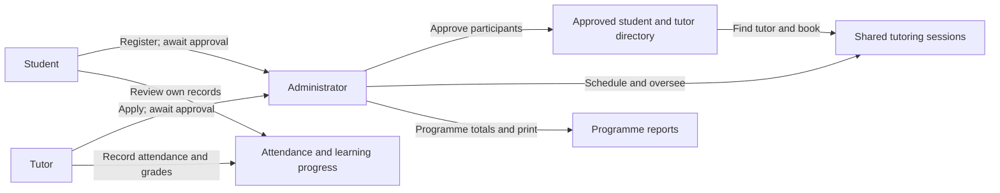

# Aspire Youth Initiative

  

Aspire Youth Initiative is a responsive web app for coordinating a youth tutoring programme. It brings students, tutors, and programme administrators together to manage registrations, tutoring sessions, attendance, and learning progress in one shared system.

> **Project status:** This repository contains a working browser-based application backed by Firebase. It is not a production-ready, secured service until the deployment and database-rule requirements in [Security and deployment](#security-and-deployment) are addressed.

## What the app does

The app has three role-specific experiences:

| Role | Main capabilities |
| --- | --- |
| **Student** | Register for approval, find approved tutors by name or subject, book a session, and review sessions, attendance, grades, and progress. |
| **Tutor** | Apply for approval, view assigned students and sessions, record attendance, add grades, and see student averages. |
| **Administrator** | Review student and tutor applications, add programme participants, schedule sessions, manage attendance, see programme totals, and print an attendance report. |

New student and tutor accounts start as **Pending**. An administrator must approve an account before its user can sign in to the corresponding role dashboard.

## Screens and programme flow

## Design considerations

- **Role-focused navigation:** Each role sees the tasks and records relevant to their work. Student, tutor, and administrator views have separate dashboards and navigation.
- **Responsive layout:** The interface uses Bootstrap's responsive grid, a collapsible small-screen navigation menu, and a wider desktop sidebar. The sign-in screen also adapts to narrow displays.
- **Readable, consistent visual language:** Aspire branding, a navy-and-green palette, Figtree typography, clear status badges, and summary cards distinguish actions and programme states.
- **Accessible interaction:** Forms use labels and native validation; status messages use live-region roles; tables are horizontally scrollable on narrow screens; visible keyboard focus and reduced-motion preferences are supported.
- **Input and output handling:** Registration fields have length and format checks, phone numbers are limited to ten digits, grade scores are bounded from 0 to 100, and user-provided text is escaped before it is rendered in HTML.
- **Consistent scheduling records:** Bookings check for tutor and student time conflicts. Attendance is recorded against a session and cannot be entered twice for the same session through the app.
- **Shared and resilient data:** Firebase Realtime Database provides the shared programme data. Writes are transaction-based and queued, and the client merges its changes with the latest database state to reduce accidental overwrites. Existing browser-stored programme data can be used to initialize Firebase when the database is empty.
- **Brand assets:** The primary sign-in logo is [`logo-clean.png`](assets/images/logo-clean.png); [`logo.png`](assets/images/logo.png) is also included in the image assets.

## Technology and data

- **Frontend:** `index.html` is a single-page application written in browser-native HTML and JavaScript modules; `assets/style.css` contains the app styling.
- **UI libraries:** Bootstrap 5.3.3 and the Figtree font are loaded from public CDNs.
- **Authentication:** Firebase Authentication's Email/Password provider handles student and tutor credentials. Passwords are not stored in the app's Realtime Database.
- **Database:** Firebase Realtime Database stores programme records under `/ayi`. User profiles are represented under `/ayi/users/{uid}` and the corresponding `/ayi/students/{uid}` or `/ayi/tutors/{uid}` role collection.
- **Cross-client profile contract:** [`FIREBASE_AUTH_SETUP.md`](FIREBASE_AUTH_SETUP.md) describes the shared Firebase profile structure and setup notes for the related Android client.

## Run locally

1. Configure the Firebase project and enable the Email/Password sign-in provider. See [`FIREBASE_AUTH_SETUP.md`](FIREBASE_AUTH_SETUP.md) for the setup and profile contract.
2. Serve the project root using a local web server, or deploy it over HTTPS. Do not open `index.html` directly as a `file://` URL.
3. Visit the served page in a modern browser. The app connects to Firebase and displays a connection or permission error if it cannot load its data.
4. Change the legacy website administrator credentials in `index.html` before any deployment. The app currently shows a warning about these credentials on its admin sign-in screen.

The project does not currently include a package manifest, build step, or automated test suite.

## GitHub and GitHub Actions

The source is hosted in [Thabanglets/AspireYouthSystem_Web](https://github.com/Thabanglets/AspireYouthSystem_Web). GitHub provides the project history and the `main` branch. Issues and pull requests are suitable places to track bugs and proposed changes; review and test changes before merging them into the default branch.

**GitHub Actions is not configured in this repository yet:** there are no workflow files under `.github/workflows/`, and no automated checks or deployments currently run on pushes or pull requests. A future Actions workflow could run HTML/JavaScript validation and focused tests on pull requests, then deploy only after the project has a reviewed, secure hosting and Firebase configuration. Until such a workflow is added, do not treat a successful push as a verified build or deployment.

## Security and deployment

This repository includes demo-oriented configuration that must not be mistaken for production security:

- [`database.demo-only.rules.json`](database.demo-only.rules.json) permits public read and write access. It is explicitly for fake-data demonstrations only; do not publish these rules for real users or real programme data.
- The legacy website administrator login is implemented in client-side code. A client-side credential or role check is not a secure authorization boundary. Replace it with trusted authentication and server-enforced authorization before production.
- Configure restrictive, role-aware Realtime Database rules. Hiding controls in the interface does not prevent a user from accessing the database directly.
- Restrict the Firebase web API key to the intended services and domains in Firebase Console. A browser Firebase API key is configuration, not a substitute for database authorization.
- Use HTTPS, enable and test the required Firebase Authentication provider, and review account approval and recovery procedures before inviting real users.

For detailed Firebase setup and the limits of the demo rules, read [`FIREBASE_AUTH_SETUP.md`](FIREBASE_AUTH_SETUP.md).

## Release notes

### Current web edition — prototype-to-current feature inventory

**Innovative features highlighted in this edition**

- **Approval-gated onboarding:** Students can register and tutors can apply; administrators review each application before access is granted.
- **Student-led tutor discovery and booking:** Students can search approved tutors by name or subject and book a session, with checks against tutor and student scheduling conflicts.
- **Role-specific programme management:** Administrators schedule sessions and manage participants, while tutors see their own students and sessions and students see their own learning records.
- **Connected learning progress:** Tutors can enter grades; students can view grades and performance summaries; attendance is linked to sessions and contributes to attendance summaries.
- **Live shared records:** Firebase Realtime Database keeps programme data shared between app users, with queued transactional writes and change merging to help protect concurrent updates.
- **Print-ready reporting:** Administrators can view programme totals and print an attendance report from the browser.
- **Responsive, branded interface:** The app includes dedicated role dashboards, a mobile-friendly menu, accessible focus and feedback states, and a print layout.
- **Firebase Authentication integration:** Student and tutor credentials use Firebase Authentication, with profile records written using the shared Aspire Youth profile structure documented for the related client.

This feature inventory describes the current implementation; it is not a verified chronological change list. The available GitHub history begins with a commit that already contains the application, and the prototype baseline or earlier release notes are not preserved here. As a result, the repository does not provide enough evidence to identify every change made *since* the prototype or to establish when each feature was introduced. No version number or release date is assigned.

### Repository changes visible in Git history

- The first recorded project commit added the web app, Firebase integration and setup guide, styles, Aspire logo assets, and demo-only database rules.
- No earlier prototype baseline, tagged release, or subsequent feature commits are present in the available repository history.
